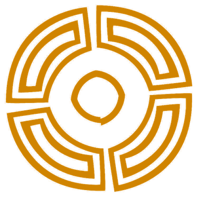

# La Caetra · retrocultura

Proyectos libres de [La Caetra, retrocultura](https://lacaetra.com/): cultura
antigua y pagana, calendarios, chapas… y algo de código.

## Proyectos

| Proyecto | Qué es |
|---|---|
| [**Calendario Pagano**](calendario-pagano/) | Rueda del año como widget de escritorio para Linux (Cinnamon, GNOME, KDE Plasma y otros), Windows y macOS: las ocho fiestas, el día del calendario celta de Coligny y la fase lunar. |

Cada proyecto vive en su carpeta, con sus instrucciones de instalación. Los
paquetes listos para instalar están en **[Versiones](https://github.com/LaCaetra/lacaetra-retrocultura/releases)**.

## Apoya el proyecto

Todo lo que hay aquí es libre y gratuito. Si te gusta y quieres ayudarnos a
seguir haciendo cosas, puedes hacer una donación, puntual o periódica, en
**[Liberapay](https://liberapay.com/lacaetra/donate)**, una plataforma europea,
libre y sin ánimo de lucro.

¡Gracias!

## Licencias

- **Código**: GNU GPL v3 o posterior ([LICENSE](LICENSE)).
- **Contenidos** (textos, diseño, ilustraciones, paleta e iconos): Creative Commons
  Reconocimiento-CompartirIgual 4.0 ([LICENSE-CC-BY-SA-4.0.txt](LICENSE-CC-BY-SA-4.0.txt)).

Autoría de contenidos: Andrea M. Miranda Duque y Fernando A. Muñoz Villarejo.
