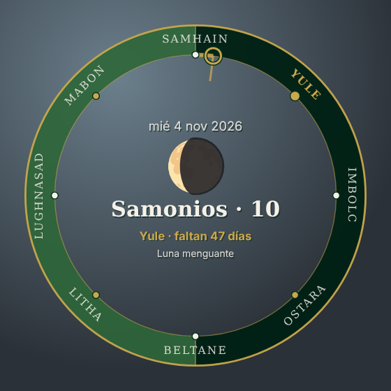

# Calendario Pagano · rueda del año

Widget de escritorio con la **rueda del año**: las ocho fiestas, el día del
**calendario celta de Coligny** y la **fase lunar** de hoy, con la cuenta atrás
hasta la próxima fiesta. Funciona sin conexión.



## Instalación

Descarga el paquete de tu sistema en **[Versiones](https://github.com/LaCaetra/lacaetra-retrocultura/releases)**.

| Sistema | Paquete | Tipo |
|---|---|---|
| Linux · Cinnamon (Mint, Fedora Cinnamon…) | `calendario-pagano-cinnamon-*.zip` | desklet |
| Linux · GNOME 45 a 51 (Debian, Ubuntu, Fedora…) | `calendario-pagano-gnome-*.zip` | extensión |
| Linux · KDE Plasma 6 (Kubuntu, Fedora KDE, Debian…) | `calendario-pagano-plasma-*.plasmoid` | plasmoide |
| Linux · XFCE, MATE, Budgie y otros | `Calendario.Pagano_*_amd64.deb`, `.rpm` o `.AppImage` | app de escritorio |
| Windows 10 y 11 | `Calendario.Pagano_*_x64-setup.exe` | app de escritorio |
| macOS | `calendario-pagano-macos-ubersicht-*.zip` | widget de Übersicht |

**📖 [Guía de instalación paso a paso para cada escritorio](INSTALAR.md)**, con
instrucciones para desinstalar y qué hacer si algo no funciona.

Lo más importante:

- **GNOME**: después de instalar la extensión hay que **cerrar la sesión y volver
  a entrar** antes de activarla.
- **Windows**: si SmartScreen avisa, pulsa **Más información → Ejecutar de todas formas**.
- **App de escritorio** (Windows, XFCE, MATE…): la rueda se arrastra con el ratón y
  sus opciones están en el icono junto al reloj.

## Cómo se calculan las fechas

Según la *Guía de festividades* de La Caetra:

- **Yule, Ostara, Litha y Mabon**: solsticios y equinoccios (algoritmo de Meeus,
  con unos minutos de error).
- **Samhain, Imbolc, Beltane y Lughnasad**: segunda luna llena tras el solsticio
  o equinoccio anterior.
- El **año celta** empieza en Samhain y **cada mes empieza con su luna llena**: dura
  29 días (*anmatos*) o 30 (*matos*) según la luna real. Los años de 13 lunas
  tienen un mes extra, **Mid Samonios**.
- La **fase lunar** usa la tabla del Observatorio Astronómico Nacional (IGN) para
  2026; fuera de ese año, un cálculo aproximado (unas horas de error). Una luna
  llena muy cerca de medianoche podría mover una fiesta un día.

## Desarrollo

Todas las versiones salen del mismo núcleo, así que una corrección en `core/`
llega a todas:

```
core/coligny.js              motor del calendario y dibujo de la rueda (sin dependencias)
core/adapters/cairo-gjs.js   dibujo con Cairo + Pango (Cinnamon y GNOME)
core/adapters/canvas2d.js    dibujo con Canvas 2D (web, Tauri, Übersicht y QML de KDE)
targets/                     plantillas de cada escritorio
build.mjs                    genera dist/ y los paquetes
tests/                       pruebas del motor
```

```bash
node build.mjs                       # genera dist/ y dist/paquetes/
node --test "tests/*.test.mjs"       # pruebas del motor
xdg-open "dist/web/index.html?fecha=2026-10-28"   # vista previa de cualquier día
```

Los paquetes de cada versión se compilan solos en GitHub Actions al crear una
etiqueta `calendario-pagano-vX.Y.Z` (ver `.github/workflows/`). Para compilar la
app de escritorio a mano (Tauri 2; requiere Rust y las dependencias de Tauri):

```bash
node build.mjs
cd targets/tauri
npx @tauri-apps/cli@2 build --bundles deb,rpm,appimage       # Linux
scripts/build-windows.sh                                     # Windows, desde Linux
cd ../.. && node build.mjs     # copia los paquetes compilados a dist/paquetes/
```

La app Tauri también compila en un Mac (`--bundles dmg`), pero sin la firma de
Apple (99 $/año) el sistema la bloquea al abrirla; por eso en Mac se distribuye
el widget de Übersicht.

## Cómo se ha hecho

Este software ha sido desarrollado con la ayuda de Claude, el asistente de IA de
Anthropic. El diseño, los contenidos y las decisiones son de La Caetra.

## Autoría y licencia

Autoría de contenidos: **Andrea M. Miranda Duque** y **Fernando A. Muñoz
Villarejo** - [La Caetra, retrocultura](https://lacaetra.com/).

- Código: [GPL-3.0-or-later](../LICENSE).
- Contenidos (textos, nombres y descripciones de las fiestas, diseño de la rueda,
  paleta e icono): [CC BY-SA 4.0](../LICENSE-CC-BY-SA-4.0.txt).
- El nombre y el logotipo de La Caetra son marca nuestra y no entran en esas
  licencias: las versiones modificadas deben llevar otro nombre e icono y no
  presentarse como oficiales ([detalles](../README.md#marca)).

Si te gusta y quieres apoyarnos: **[Liberapay](https://liberapay.com/lacaetra/donate)**.
